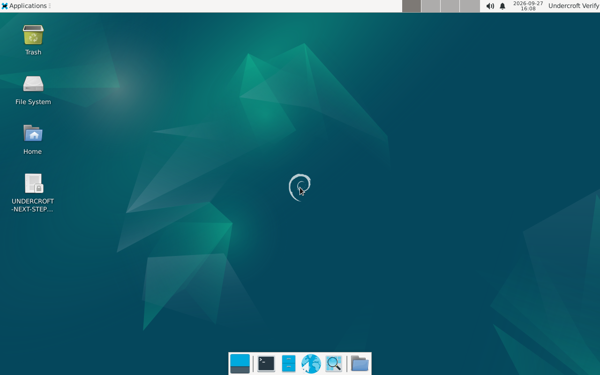
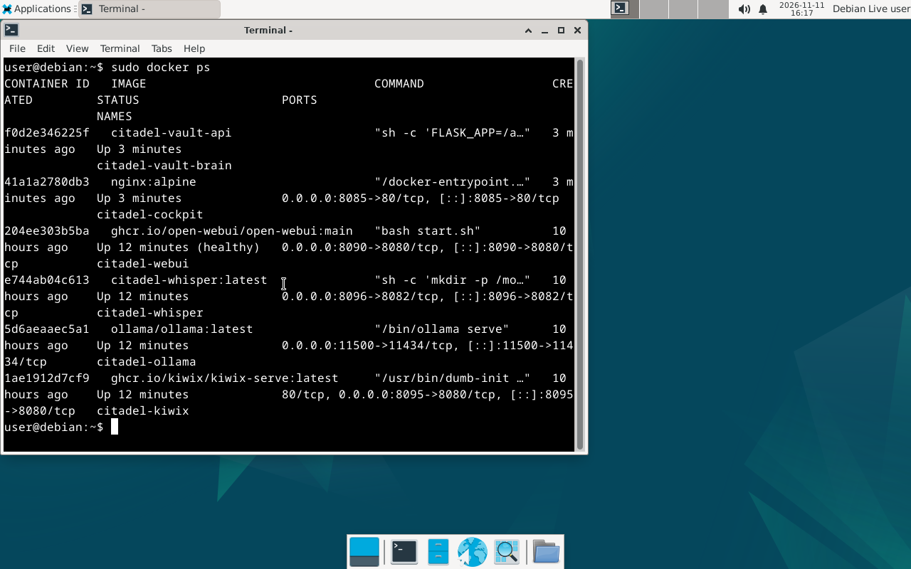

<p align="center">
  
</p>

# Undercroft

**The ground everything else stands on.** Undercroft turns a bare Debian 12 desktop or laptop into a ready-to-go appliance station for the [Citadel](https://github.com/frankprobst5-stack/Project-Citadel) / [WayStation](https://github.com/frankprobst5-stack/WayStation) ecosystem — Docker installed and running unattended, radio hardware permissions and tooling already in place, a real Xfce desktop, and a first-boot handoff straight into Citadel's own installer.

It's the OS layer, not an app: install it once on the machine that's going to run your station, and everything else in the ecosystem just works on top of it.

<p align="center">
  
</p>

---

## Two real products from this repo

- **Undercroft Full** — the installable OS described above: Calamares walks you through putting Undercroft on a machine's own disk, permanently, as its daily-driver OS.
- **Undercroft Pocket** — a live-boot USB build of the exact same image, designed to carry in a pocket and plug into *any* machine in an emergency, with no install step at all. Covered in its own section below.

Both come from the same `sandbox/build-iso.sh` recipe — Pocket is Full's live-boot mode with a curated offline module set staged onto the image, not a separate project.

## Status: source release, build-it-yourself

There's no downloadable installer image on this repo's Releases page — Undercroft produces a real ISO, and a live-build+Calamares image is too large and too build-specific (kernel/firmware versions drift constantly) to ship as a static download. Instead, you build it from source, which takes about an hour the first time and is fully scripted.

Undercroft Full (the desktop/laptop tier this repo covers) is real, hands-on tested, and verified end-to-end — a completed install boots standalone, Docker comes up active with no one logged in, and the radio tooling (Direwolf, JS8Call, Pat, rtl-sdr, hamlib) is present and on `PATH`. Undercroft Pocket has gone through a full, real, end-to-end validation cycle of its own — see below. What's honestly still open:

- **Undercroft Lite (Raspberry Pi 4/5)** hasn't been started — this repo is Full/Pocket only for now.
- **Neither Full nor Pocket has been tested on real physical hardware yet** — every validation so far (the boot-console QR display, the laptop lid-switch fix, the GPS/chrony time stanza, and all of Pocket's own testing) has run inside a QEMU/KVM sandbox. Flashing a real USB stick and booting real hardware is the next real milestone.
- **No code-signing/notarization** — this is a Linux ISO built from a script you can read yourself, not a signed vendor image.

See [ROADMAP.md](ROADMAP.md) for the full, honestly-tagged build log — what's verified, what's simulated, what's still just planned.

## Requirements

- An x86-64 desktop or laptop, and a blank USB stick (8GB+ for Full's installer; 1TB+ recommended for Pocket, see below) to install from.
- **Debian 12 (bookworm)** as the base — the full ISO installer (Option A below) installs Debian for you from scratch; the alternative path (Option B) provisions an existing Debian 12 machine in place.
- Real internet access during the build/install itself (it's pulling several hundred real packages, plus Pocket's own curated offline bundle); the whole point of the result is that it doesn't need that afterward.

## Getting it

**Option A — build a bootable installer ISO** (recommended for a fresh machine):

```bash
cd sandbox
mkdir -p build-output
docker run --rm --privileged \
    -v "$(pwd)/build-output":/output \
    -v "$(pwd)/build-iso.sh":/build-iso.sh:ro \
    -v "$(pwd)/../brand":/brand:ro \
    -v "$(pwd)/pocket-assets":/pocket-assets:ro \
    debian:12-slim bash /build-iso.sh
```

This produces `sandbox/build-output/undercroft-sandbox.iso` — a real Debian 12 + Xfce + Calamares live image with Docker, the radio stack, Undercroft Pocket's own offline bundle, and Undercroft's own hardening already baked in. Flash it to a USB stick (`dd`, Rufus, Balena Etcher, whatever you're used to) and boot the target machine from it; Calamares walks you through the rest.

Before writing it to real hardware, you can also boot it in the same QEMU/noVNC sandbox this project uses for its own testing — see [sandbox/README.md](sandbox/README.md).

**Option B — provision an existing Debian 12 install in place:**

```bash
git clone https://github.com/frankprobst5-stack/Undercroft.git
cd Undercroft
sudo ./provision.sh
```

Use this if you've already got Debian 12 installed the normal way and just want Undercroft's own layer (Docker, radio permissions, the Xfce Workstation profile, the branded desktop, hardware hooks) added on top.

Either way, provisioning ends by handing off to Citadel's own installer — `cd ~/citadel && ./install.sh` — which is where you pick which Citadel modules actually run.

## What it sets up

- **Docker Engine**, installed via the real official `docs.docker.com` repo and enabled to survive a reboot with no one logged in — this is what Citadel itself runs on.
- **Radio-ready permissions and tooling**: `dialout`/`plugdev` group membership, `rtl-sdr`'s own udev rules, and Direwolf/JS8Call/Pat/hamlib pre-installed for WayStation's local-hardware modules.
- **A real Xfce desktop** (Workstation profile) with Firefox ESR standing in for [Gated](https://github.com/frankprobst5-stack/Gated) until that project has real code, and the Citadel Ecosystem crest as the desktop background.
- **A no-keyboard boot console**: mDNS hostname, IP, and a scannable QR to the Citadel dashboard, printed on every real boot.
- **Laptop-specific behavior** (only applied if a battery is detected): ignores the lid switch so the station keeps serving while closed.
- An inert, ready-to-activate **GPS time stanza** for offline-capable clock sync — just needs a real USB GPS plugged in.

---

## Undercroft Pocket: carry Citadel in your pocket

<p align="center">
  
</p>

The idea: a real emergency doesn't wait for you to be at your own machine. Undercroft Pocket is a live-boot build of this same OS, carrying a curated, offline-complete slice of the Citadel ecosystem, meant to live in a pouch next to an SDR kit — plug it into *any* x86-64 machine you can find, and it boots straight into a working station, no install, nothing left behind on the host.

**What's on it, and why this list and not everything:** the design principle, straight from how this was scoped — keep the home station full-featured, carry a fast, scaled-down version. Pocket currently ships:

- **Ollama** (`llama3.2:1b`) — a real local LLM, no internet needed.
- **A curated 10-file Kiwix reference library** (~10GB — ready.gov, medical/military-medicine references, iFixit, CDC, compact survival-skill guides) — deliberately *not* the full 700GB+ Kiwix archive.
- **Whisper** (`whisper.cpp`, CPU-only) — offline speech-to-text.
- **Baneward's wild-plant/poison database** (a lean 216MB core).
- **Vault** (Citadel's own notes/knowledge-base API) and **Cockpit** (the dashboard tying it together).
- **Muster**, for ops coordination once you're on a shared network with others.

Explicitly **not** included by default: the RTL-SDR-dependent modules (`scanner`, the trunked-radio decoder, and `intercept`, the 433MHz ISM-band viewer) — both need a real USB SDR dongle, and a "plug into whatever machine is available" drive shouldn't assume one is attached. They're still real, working modules if you *do* have a dongle: `docker compose --profile hardware up -d` starts them explicitly.

**Real, honest state — end-to-end validated, not just built:**

- **The hard part — a real, kernel-level storage bug — is solved.** Docker's default `overlay2` driver fails outright (`operation not permitted`, mid-pull) when its own data directory sits on live-boot's own persistence overlay, itself an overlayfs mount — overlay-on-overlay isn't supported by the kernel. Pocket's first-boot script detects the real, flat partition underneath that overlay and points Docker's `data-root` there directly with the `vfs` storage driver, which has no overlay/whiteout semantics to trip over. Confirmed fixed by a full from-scratch pull/build/run of every module, repeatedly, across several independent test cycles.
- **Real sizing, not guessed**: `vfs` trades away layer deduplication for that fix — every image needs its own full, uncompressed copy, and so does every container built from it. Measured directly (not estimated) across this module set's real footprint, the working number is a **1TB target drive**. Current retail pricing made this an easy call — a 1TB USB 3.2 stick runs **$105–130** (SanDisk Extreme PRO class), barely more than 512GB.
- **Fully automated first boot, proven unattended**: the whole pull/build/start pipeline — no cached images, no manual steps — runs as a single `systemd` service on first real boot, with no artificial timeout (an earlier fixed ceiling was tried, found still too short on a real test run, and replaced with none at all, since this is a genuine one-time cost that only ever happens once per drive).
- **A real memory-safety bug found and fixed**: Open WebUI's own container memory cap was tighter than its real steady-state usage, causing the kernel to repeatedly kill and restart it. Raised with real headroom; confirmed stable afterward with zero further kills.
- A GUI session-lockout bug (the default idle-lock screen, with no password the operator could ever actually use to get back in) is found and fixed too — a real problem for a drive meant to be handed to someone who isn't a Linux person in the middle of an actual emergency.

See [ROADMAP.md](ROADMAP.md)'s own Undercroft Pocket entries for the complete, warts-and-all investigation — every bug found, how it was diagnosed, and exactly what was fixed.

**Flashing a real drive**: `sandbox/make-pocket-usb.sh` writes the built ISO to a real USB device and carves a second partition out of whatever space is left over, formatted as live-boot's own persistence overlay — this is what makes a Pocket drive remember state (synced data, logs) across a reboot of the same drive, not just within one session.

```bash
sudo ./sandbox/make-pocket-usb.sh /dev/sdX sandbox/build-output/undercroft-sandbox.iso
```

**Not yet done**: real physical hardware. Every validation above ran in this project's own QEMU/KVM sandbox — a real USB stick, booted on a real borrowed machine, is the next real milestone.

---

## License

GPL-3.0-or-later — see [LICENSE](LICENSE). This covers Undercroft's own scripts (`provision.sh`, everything under `sandbox/`) only. Debian itself and every package it installs (Docker, Xfce, Direwolf, JS8Call, Pat, Ollama, Open WebUI, Kiwix, etc.) are pulled from their own upstream repositories and keep their own licenses, unmodified and uncombined with this project's code.
